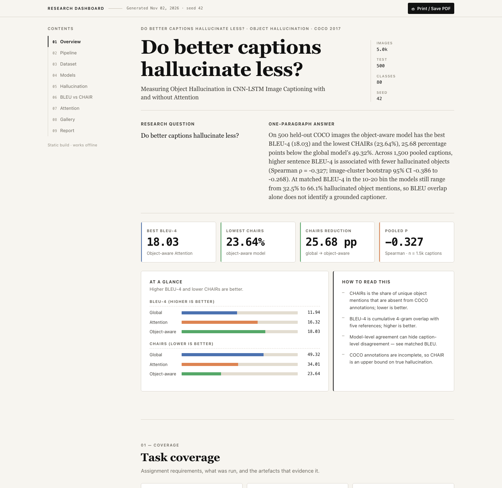

# Dashboard

A static, offline research dashboard for the CNN–LSTM captioning / object-hallucination study.
No server, no build step, no network requests.

## Screenshot



## Open it

```bash
open "dashboard/index.html"
```

Or double-click `dashboard/index.html`. It works from `file://`.

## What it contains

| Section | What it shows |
|---|---|
| Overview | Research question, one-paragraph answer, KPI cards, BLEU/CHAIR bars |
| Pipeline | 8 assignment task cards with evidence links + a 6-step reproducible pipeline |
| Dataset | Re-split composition, caption statistics, top COCO objects, detector details |
| Models | Three model cards, full 13-column metrics table (sortable), training curves |
| Hallucination | CHAIRs/CHAIRi comparison, most hallucinated classes, 6 worked examples |
| BLEU vs CHAIR | Correlations, BLEU-4 quartiles, matched-BLEU chart, scatter figure |
| Attention | Example selector, word chips, overlay/base toggle, overlay images |
| Gallery | 8 held-out examples with model filter and caption search |
| Report | DOCX / PDF / CSV downloads, reproducibility notes, figure lightbox, print |

## Rebuild the data

```bash
.venv/bin/python scripts/build_dashboard.py
```

This regenerates:

- `dashboard/data/dashboard.json` — machine-readable payload
- `dashboard/data/dashboard-data.js` — same payload as `window.DASHBOARD_DATA`
- `dashboard/assets/images/` — selected COCO images
- `dashboard/assets/attention/` — per-word attention overlays
- `dashboard/assets/figures/` — report figures
- `dashboard/assets/downloads/` — report DOCX/PDF and metric CSV

The builder reads existing artefacts only; it never retrains or recomputes metrics.
`--limit N` writes to `dashboard/data/smoke/` so the full payload is never clobbered.

## Verify

```bash
.venv/bin/python -m unittest tests.test_dashboard_data -v
```

28 contract tests cover schema ordering, coverage counts, percentages, asset paths,
strict JSON, the JS wrapper, idempotency and missing-artifact behaviour.

## Files

```text
dashboard/
  index.html            semantic shell (9 hash sections + lightbox + error panel)
  styles.css            design tokens, components, responsive/print/reduced-motion
  app.js                renders from window.DASHBOARD_DATA (vanilla JS, no innerHTML)
  data-contract.md      payload schema the builder and UI agree on
  data/                 generated payload (JSON + JS wrapper)
  assets/               generated images, overlays, figures, downloads
```

Design: editorial/technical light theme, serif headings, monospace metrics,
model colours `#4C72B0` / `#DD8452` / `#55A868`.
