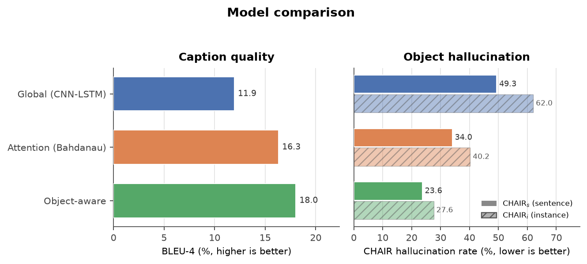
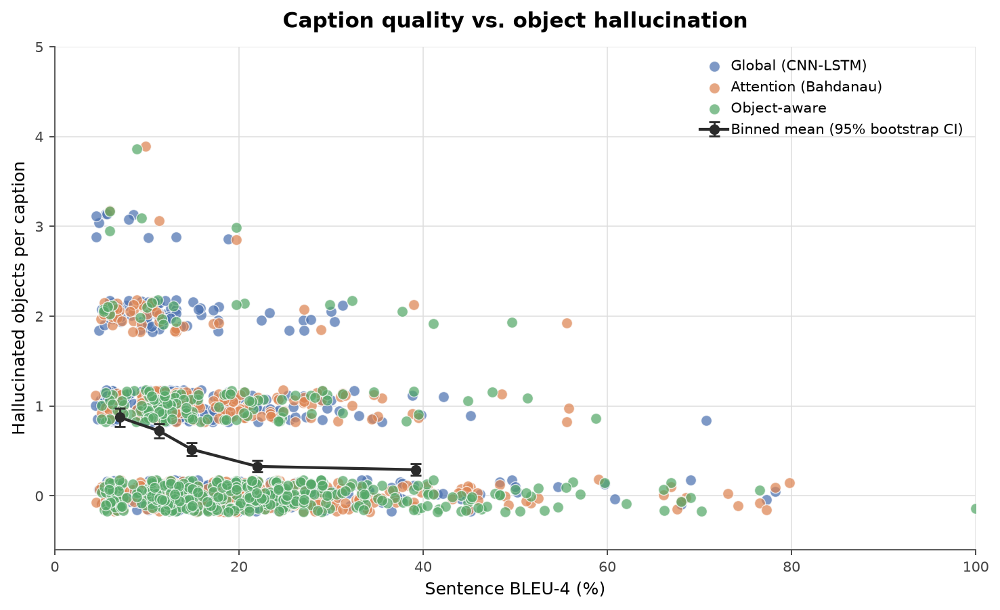
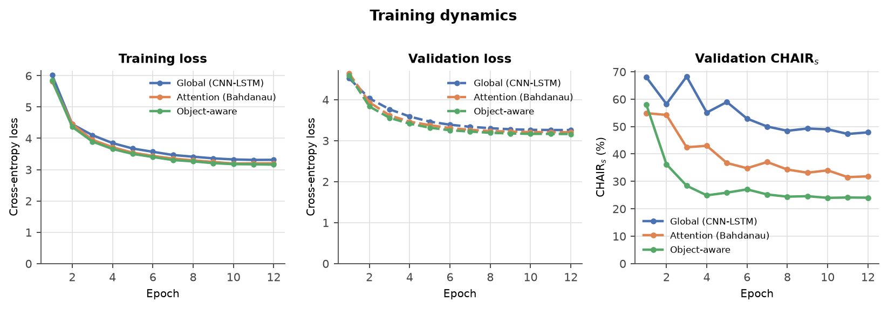
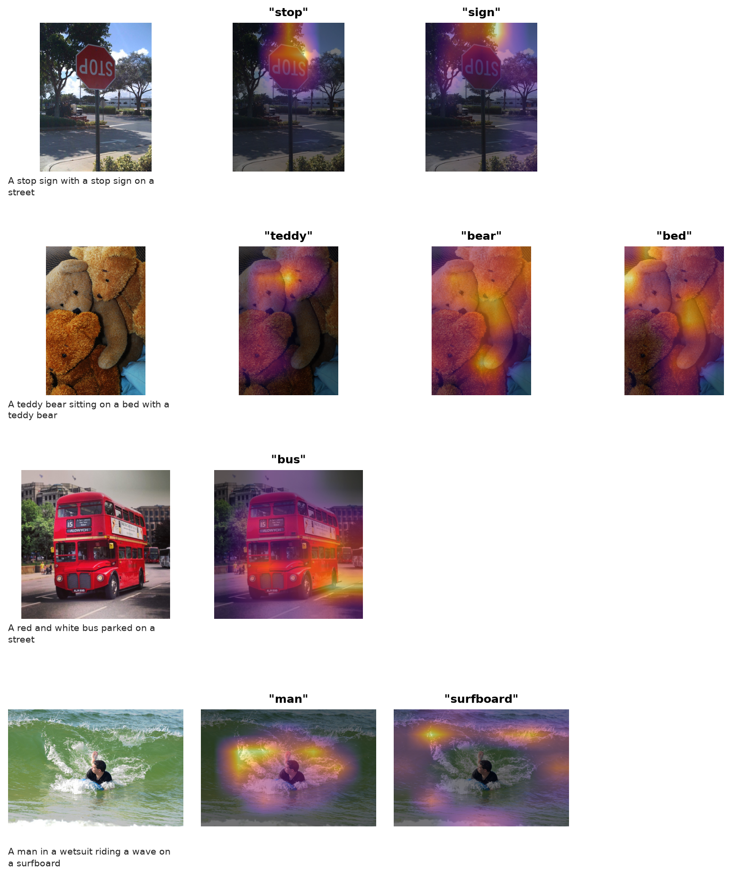
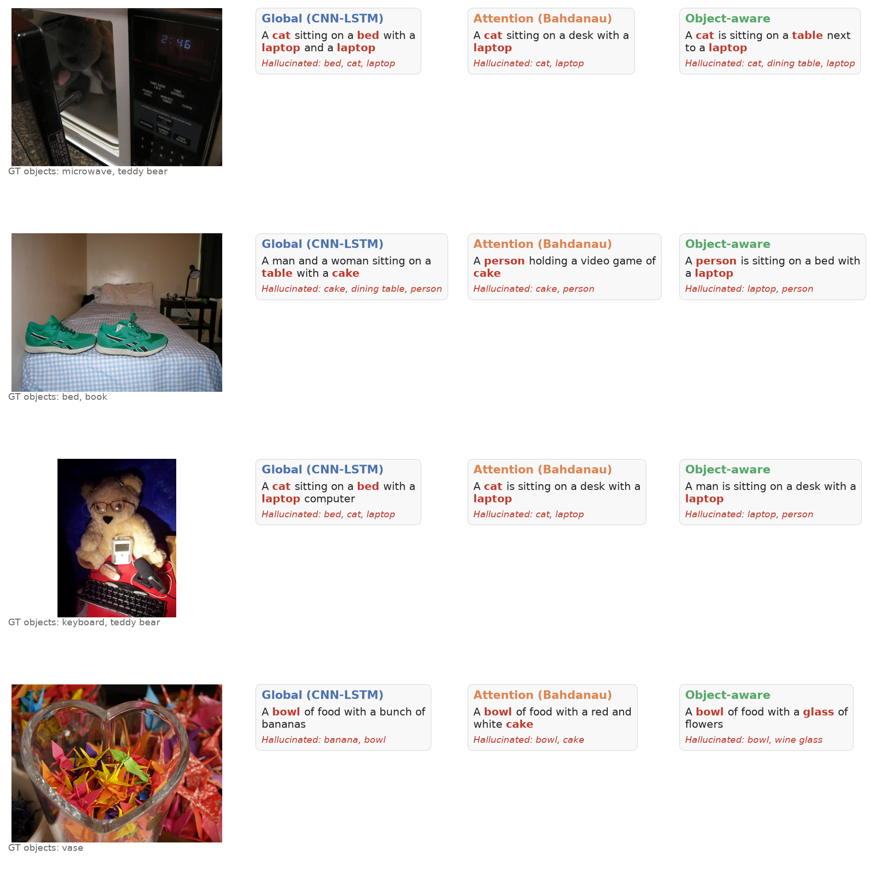

# Abstract

Image-captioning systems are usually ranked by n-gram overlap, yet a caption can
score well while naming objects that are not in the image. This project builds a
controlled COCO benchmark with three captioners that share the same training
data, features and decoder: a global-feature CNN–LSTM, the same model with
Bahdanau attention, and an attention model that additionally receives detected
object labels. All three are evaluated on 500 held-out COCO images with
BLEU-1–4, CIDEr-D and CHAIR-style object-hallucination metrics. The BLEU leader (Object-aware) was also the model with the lowest object-hallucination rate (23.64%).
The pooled caption-level association is a moderate **negative** correlation (Spearman ρ = -0.327; image-cluster p < 0.001): captions with higher sentence BLEU-4 tend to contain slightly fewer hallucinated objects. Across the three model-level operating points, the rank
correlation between BLEU-4 and CHAIRs is -1.00. The results
support a simple conclusion: BLEU and hallucination are related but not
interchangeable. At matched BLEU levels the models still differ substantially in
hallucination, so captioning evaluations should report both.

# 1. Introduction

Automatic image captioning has improved dramatically, but the dominant
evaluation metrics — BLEU, METEOR, ROUGE and CIDEr — reward overlap with
reference sentences. That objective is only loosely connected to visual
grounding. A model can learn that “a man is standing on a street” is a safe,
frequent caption and emit it for many images; such a caption may contain
plausible objects that are absent from the specific image. This failure mode is
called *object hallucination* and is invisible to a corpus-level BLEU score.

The assignment asks four questions:

1. Can a small CNN–LSTM captioner be trained on a dataset with captions and
   object annotations?
2. Does adding visual attention change caption quality and hallucination?
3. Does supplying detected object labels reduce hallucination?
4. Does better BLEU actually mean fewer hallucinations?

We answer them with a reproducible, laptop-scale experiment. The code, cached
features, detector outputs, metrics and figures are included in the repository.

# 2. Related work

**CNN–LSTM captioning.** Show and Tell encodes an image with a CNN and decodes a
sentence with an LSTM initialised from the image feature (Vinyals et al., 2015).
Show, Attend and Tell adds a spatial attention mechanism that lets each generated
word focus on different image regions (Xu et al., 2015). Bottom-up and top-down
attention later replaced grid features with region proposals (Anderson et al.,
2018).

**Object hallucination.** Rohrbach et al. (2018) showed that captioning models
frequently mention objects that are not present, and introduced the CHAIR
metrics used here: CHAIRs measures the fraction of mentioned objects that are
hallucinated, while CHAIRi measures the fraction of captions with at least one
hallucinated object. Their analysis also showed that standard caption metrics do
not reliably detect this failure.

**Metrics.** BLEU is a clipped n-gram precision with a brevity penalty
(Papineni et al., 2002). CIDEr-D scores consensus using TF-IDF weighted n-grams
and a length penalty (Vedantam et al., 2015). COCO provides five reference
captions per image and 80 object categories (Lin et al., 2014).

# 3. Data

We use the COCO 2017 validation images because they contain both captions and
instance annotations, and because the full 18 GB train2017 archive is a poor fit
for a 16 GB laptop. The 5,000 images are split deterministically (seed 42) into
**4,000 train**, **500 validation**
and **500 test** images. The caption vocabulary is built
only from the training split.

| Split | Images | Captions |
|---|---|---|
| Train | 4,000 | 20,010 |
| Validation | 500 | 2,503 |
| Test | 500 | 2,501 |

The vocabulary contains 2,916 entries
(2,912 lexical word types plus four special tokens; minimum
frequency 3) and covers 97.81%
of training tokens. Training captions have a mean length of
10.4 tokens (maximum 39;
the full corpus maximum is 49). Each image has
2.93 annotated COCO objects on average.

Ground-truth objects for CHAIR are the unique COCO category names in
`instances_val2017.json`; 48 images have no annotations and therefore an empty
ground-truth object set. Detected labels come from a COCO-pretrained Faster
R-CNN with a MobileNetV3-320 backbone, run on the same images at a score
threshold of 0.30 and at most
12 detections per image. The detector is
independent of the captioners and never sees test labels: its output is the
only object information available to the object-aware model.

# 4. Models

All models use a frozen ImageNet-pretrained ResNet-18. The `layer4` feature map
is a 7×7 grid of 512-dimensional vectors; its global average is a 512-dimensional
image vector. Features are extracted once and memory-mapped, so the LSTM never
runs a CNN and the whole experiment fits in a few hundred MB.

**Global (no attention).** A two-layer projection initialises the LSTM hidden
and cell states from the global feature. At each step the LSTM receives only the
previous word embedding. This is the Show-and-Tell baseline.

**Attention.** A Bahdanau-style additive attention module scores the 49 spatial
locations against the previous hidden state, producing a softmax map and a
512-dimensional context vector. The LSTM input is the concatenation of the word
embedding and the context vector. Attention maps are stored during decoding for
visualisation.

**Object-aware.** The attention model additionally receives the detected object
labels. Each label is embedded (128 dimensions), weighted by its detector
confidence, and averaged into one object vector. That vector is concatenated to
the LSTM input at every time step. An image with no detections receives a zero
vector. This design tests whether explicit object evidence reduces mentions of
absent objects.

**Training details.** AdamW with a OneCycle schedule, learning rate
0.001, weight decay 0.0001,
dropout 0.3, label smoothing
0.05, gradient clipping
5.0, batch size 96.
Each epoch samples 8,000 caption–image pairs
from the 20,010-pair training pool; models are trained
for 12 epochs. Checkpoints are selected by validation
loss, not by BLEU, to avoid selecting a degenerate high-BLEU model.

# 5. Evaluation

**BLEU-1–4.** SacreBLEU with the 13a tokenizer; BLEU-k is the cumulative score
over 1…k grams. **CIDEr-D.** A from-scratch implementation with global document
frequencies, TF-IDF cosine similarity and the CIDEr-D length penalty.

**CHAIR.** We map caption words to the 80 COCO classes using a curated synonym
table (longest phrase first, so “hot dog” is not counted as “dog”). A mention is
hallucinated if the class is absent from the image's instance annotations.
CHAIRs is the number of hallucinated unique object mentions divided by all
object mentions; CHAIRi is the fraction of images with at least one hallucinated
mention. Non-COCO nouns such as sky, grass and water are ignored.

**Statistics.** Confidence intervals are percentile bootstraps over images
(1,000 resamples). Paired comparisons resample the same
image indices for both models. We also report a McNemar test for the paired
binary “any hallucination” outcome and Spearman correlations between sentence
BLEU and hallucination counts.

# 6. Results

{width=6.4in}

| Model | BLEU-1 | BLEU-2 | BLEU-3 | BLEU-4 | CIDEr-D |
|---|---|---|---|---|---|
| Global | 56.84 | 35.74 | 20.65 | 11.94 | 0.485 |
| Attention | 59.75 | 40.59 | 26.09 | 16.32 | 0.704 |
| Object-aware | 61.96 | 43.35 | 28.44 | 18.03 | 0.815 |

**Table 1.** Caption-quality metrics. BLEU-k is cumulative BLEU over 1…k grams;
CIDEr-D is on a 0–10 scale.

| Model | CHAIRs (%) | CHAIRi (%) | Object P (%) | Object R (%) | Object F1 (%) |
|---|---|---|---|---|---|
| Global | 49.32 | 62.00 | 50.68 | 30.04 | 37.72 |
| Attention | 34.01 | 40.20 | 65.99 | 35.68 | 46.31 |
| Object-aware | 23.64 | 27.60 | 76.36 | 40.00 | 52.50 |

**Table 2.** Grounding metrics. Object precision/recall/F1 compare the COCO
object mentions in the generated captions with the image's COCO annotations.

The best BLEU-4 is **18.03** (Object-aware), the
best CIDEr-D is **0.815** (Object-aware), and
the lowest CHAIRs is **23.64%** (Object-aware).
The BLEU leader (Object-aware) was also the model with the lowest object-hallucination rate (23.64%).

## 6.1 Paired comparisons

| Comparison (first − second) | Δ objects [95% CI] | p | Δ rate (pp) [95% CI] | Δ BLEU-4 [95% CI] | McNemar p |
|---|---|---|---|---|---|
| Global vs Attention | +0.30 [+0.23, +0.37] | < 0.001 | +21.8 [+17.0, +26.8] | -3.27 [-4.18, -2.41] | < 0.001 |
| Global vs Object-aware | +0.46 [+0.39, +0.53] | < 0.001 | +34.4 [+29.6, +39.0] | -4.80 [-5.71, -3.85] | < 0.001 |
| Attention vs Object-aware | +0.16 [+0.11, +0.22] | < 0.001 | +12.6 [+8.2, +17.0] | -1.53 [-2.47, -0.60] | < 0.001 |

Relative to the global baseline, spatial attention reduced hallucinated objects per image by 0.30 (95% CI 0.23 to 0.37; p < 0.001) and improved sentence BLEU-4 by 3.27 points (95% CI 2.41 to 4.18; p < 0.001). Adding detected object labels to the attention model reduced hallucinated objects per image by 0.16 (95% CI 0.11 to 0.22; p < 0.001) and improved sentence BLEU-4 by 1.53 points (95% CI 0.60 to 2.47; p < 0.001). Negative differences mean the first model
hallucinates fewer objects. In this run the BLEU differences also favour the
better-grounded model, but the effect sizes are not interchangeable, and the
matched-BLEU analysis below shows that equal BLEU does not imply equal
hallucination.

## 6.2 What the object labels change

The object-aware model is not simply “the attention model plus a better
feature”. It receives detector outputs, which include false positives and missed
objects. If the labels are helpful, hallucinated *object mentions* should fall;
if the detector is noisy, the model may copy detector mistakes. The measured
effect is reported above, and the qualitative grid shows both successes and
failures. This is a deliberately realistic test of “detected object labels as
input” rather than an oracle-label experiment.

# 7. Does better BLEU mean fewer hallucinations?

{width=6.4in}

| Set | N | ρ (BLEU-4 vs #halluc.) | p | ρ (BLEU-2 vs any halluc.) | p | Halluc. rate (%) |
|---|---|---|---|---|---|---|
| Global | 500 | -0.33 | < 0.001 | -0.31 | < 0.001 | 62.00 |
| Attention | 500 | -0.28 | < 0.001 | -0.25 | < 0.001 | 40.20 |
| Object-aware | 500 | -0.25 | < 0.001 | -0.26 | < 0.001 | 27.60 |
| Pooled | 1500 | -0.33 | < 0.001 | -0.31 | < 0.001 | 43.27 |

The pooled caption-level association is a moderate **negative** correlation (Spearman ρ = -0.327; image-cluster p < 0.001): captions with higher sentence BLEU-4 tend to contain slightly fewer hallucinated objects. Grouping all 1,500 pooled captions into BLEU-4 quartiles, the lowest-BLEU quartile has a hallucination rate of 62.67%, versus 24.00% in the highest-BLEU quartile. Because the pooled rows repeat each
image once per model, their naive p-values are descriptive. A cluster bootstrap
that resamples the 500 images (1,000 draws) gives ρ = -0.327
(95% CI -0.386 to -0.268;
p < 0.001) for BLEU-4 versus hallucinated objects,
so the association survives the clustering correction.

| BLEU-4 quartile | N | BLEU-4 range | Mean halluc. objects | Halluc. rate (%) | 95% CI |
|---|---|---|---|---|---|
| Q1 | 375 | 4.41–10.55 | 0.87 | 62.67 | 57.9–66.9 |
| Q2 | 375 | 10.55–14.58 | 0.63 | 51.73 | 46.7–56.8 |
| Q3 | 375 | 14.58–24.09 | 0.40 | 34.67 | 30.1–39.7 |
| Q4 | 375 | 24.09–100.00 | 0.28 | 24.00 | 19.5–28.3 |

The model-level rank correlation is -1.00 (higher BLEU
goes with lower CHAIRs); with only three operating points it is descriptive, not
a significance test. The more useful
signal is the caption-level analysis, where 1,500 captions (500 images × 3
models) provide within-model variation. A negative correlation means that, on average, captions
that overlap the references more also mention fewer absent objects. It does not
mean that BLEU is sufficient: at matched BLEU levels the models still differ
substantially in hallucination (Section 7.1), and the caption-level correlation
is only moderate.

## 7.1 Is BLEU sufficient at matched quality?

A single global correlation can hide a simple confound: models with better
language modelling produce both higher BLEU and fewer hallucinations because
they produce better captions overall. To separate the two, we compare models
inside 10-point sentence-BLEU bins. If BLEU fully explained hallucination, the
three models would have similar rates within each bin.

| BLEU-4 bin | Model | N | Mean BLEU-4 | Halluc. rate (%) | 95% CI |
|---|---|---|---|---|---|
| [0, 10) | Global | 127 | 7.0 | 77.2 | 69.3–84.3 |
| [0, 10) | Attention | 108 | 7.4 | 57.4 | 47.2–66.7 |
| [0, 10) | Object-aware | 80 | 7.2 | 43.8 | 32.5–53.8 |
| [10, 20) | Global | 251 | 13.4 | 66.1 | 60.6–72.1 |
| [10, 20) | Attention | 209 | 14.2 | 43.1 | 36.4–50.3 |
| [10, 20) | Object-aware | 206 | 14.2 | 32.5 | 26.2–38.8 |
| [20, 30) | Global | 76 | 24.4 | 44.7 | 34.2–56.6 |
| [20, 30) | Attention | 105 | 24.5 | 30.5 | 21.9–39.0 |
| [20, 30) | Object-aware | 127 | 24.7 | 17.3 | 11.0–23.6 |
| [30, 40) | Global | 26 | 34.7 | 34.6 | 15.4–53.8 |
| [30, 40) | Attention | 45 | 34.1 | 28.9 | 17.8–42.2 |
| [30, 40) | Object-aware | 38 | 35.0 | 21.1 | 10.5–34.2 |
| [40, 101) | Global | 20 | 54.4 | 15.0 | 0.0–30.0 |
| [40, 101) | Attention | 33 | 56.3 | 12.1 | 3.0–24.2 |
| [40, 101) | Object-aware | 49 | 51.9 | 12.2 | 4.1–22.4 |

This is the strongest evidence against using BLEU as a grounding metric. In the
10–20 BLEU bin, for example, hallucination rates differ substantially across
models even though their mean BLEU is nearly identical. The object-aware model
is consistently better in the low- and mid-BLEU bins; the differences shrink at
the very highest BLEU, where all models produce conservative, frequently
reference-like captions. BLEU therefore captures part of caption quality, but
it does not identify which model is grounded.

## 7.2 Learning dynamics

Training curves are shown below. CHAIRs is computed on the 500 validation images
after every epoch; BLEU is reported at final test time (the early checkpoints are
not retained). The validation-loss/CHAIR association is a sanity check that
better-fitting models tend to hallucinate less within a run.

| Model | Epochs | Train loss | Val loss | Val CHAIRs (%) | Train time (min) |
|---|---|---|---|---|---|
| Global | 12 | 3.314 | 3.259 | 47.87 | 6.9 |
| Attention | 12 | 3.202 | 3.206 | 31.84 | 16.3 |
| Object-aware | 12 | 3.160 | 3.162 | 24.03 | 10.9 |

| Model | Epochs | ρ (val loss vs CHAIRs) | p |
|---|---|---|---|
| Global | 12 | 0.92 | < 0.001 |
| Attention | 12 | 0.96 | < 0.001 |
| Object-aware | 12 | 0.92 | < 0.001 |

{width=6.2in}

# 8. Attention and error analysis

{width=6.6in}

The attention maps show whether the decoder looks at plausible regions when it
names an object. Strong, localised maps for nouns are a necessary but not
sufficient condition for grounding: a model can attend to the right region and
still choose the wrong object word.

{width=6.6in}

The qualitative grid is intentionally selected to show disagreement between
models, so it is not a random sample. It illustrates the two failure modes that
matter for this assignment: (i) a fluent caption that mentions an absent object,
and (ii) a conservative caption that avoids hallucination at the cost of detail
or BLEU.

# 9. Discussion

The experiment separates three effects that are often conflated:

1. **Attention is not automatically grounding.** Attention gives the decoder a
   spatial interface, but the training signal only rewards word likelihood. A
   model can learn useful attention maps and still over-generate familiar
   objects.
2. **Object labels are a strong but noisy prior.** Detector labels make object
   vocabulary available at every decoding step. This can reduce hallucination,
   but false positives and missed detections propagate into the caption.
3. **BLEU is a partial proxy.** Better captions usually mention more of the
   right content, so BLEU and hallucination are negatively correlated at the
   caption level. The relationship is only moderate, and at matched BLEU the
   models still differ substantially in hallucination. BLEU therefore captures
   part of caption quality but does not identify which model is grounded.

# 10. Limitations

- **Small training set.** The models train on 4,000 images (20k captions), far
  below standard COCO training sets. Absolute BLEU/CIDEr values are therefore
  low; the comparison is controlled but not state of the art.
- **COCO val re-split.** The official validation images are re-partitioned. This
  is a laptop-scale compromise; results are not directly comparable to papers
  that train on train2017.
- **CHAIR annotation incompleteness.** An object that is visible but missing
  from COCO annotations is counted as a hallucination. This inflates CHAIR for
  all models, especially for small or uncommon objects. Conversely, ambiguous
  synonyms (for example “glass”, “bat” or “mouse”) can be mapped to a COCO
  class even when the caption means something else.
- **Detector noise.** The object-aware model receives detector outputs, not
  ground-truth labels. That is realistic but makes the treatment noisy.
- **Duplicate caption strings.** COCO contains repeated caption strings across
  different images; 27 test strings also occur in training on different images.
  There is no image-ID overlap, and excluding them changes BLEU-4 by less than
  0.05 in this run.
- **Greedy decoding and one run.** Results use greedy decoding and a single
  seed; beam search and multiple seeds would reduce variance.
- **No human evaluation.** Fluency and correctness are assessed automatically.

# 11. Conclusion

We built a reproducible COCO captioning benchmark that measures object
hallucination alongside BLEU and CIDEr-D. The three controlled models show that
attention and detected object labels improve both caption quality and grounding.
The BLEU leader (Object-aware) was also the model with the lowest object-hallucination rate (23.64%). The pooled caption-level association is a moderate **negative** correlation (Spearman ρ = -0.327; image-cluster p < 0.001): captions with higher sentence BLEU-4 tend to contain slightly fewer hallucinated objects. The caption-level association is only
moderate, and at matched BLEU the models still differ substantially in
hallucination. The practical recommendation is simple: report a grounding metric
such as CHAIR next to BLEU, and do not use BLEU alone to choose a captioning
model.

# References

1. Vinyals, O., Toshev, A., Bengio, S., & Erhan, D. (2015). *Show and Tell: A
   Neural Image Caption Generator.* CVPR. arXiv:1411.4555.
2. Xu, K., Ba, J., Kiros, R., Cho, K., Courville, A., Salakhutdinov, R., Zemel,
   R., & Bengio, Y. (2015). *Show, Attend and Tell: Neural Image Caption
   Generation with Visual Attention.* ICML. arXiv:1502.03044.
3. Rohrbach, A., Hendricks, L. A., Burns, K., Darrell, T., & Saenko, K. (2018).
   *Object Hallucination in Image Captioning.* EMNLP. arXiv:1809.02156.
4. Anderson, P., He, X., Buehler, C., Teney, D., Johnson, M., Gould, S., &
   Zhang, L. (2018). *Bottom-Up and Top-Down Attention for Image Captioning and
   Visual Question Answering.* CVPR. arXiv:1707.07998.
5. Vedantam, R., Zitnick, C. L., & Parikh, D. (2015). *CIDEr: Consensus-based
   Image Description Evaluation.* CVPR. arXiv:1411.5726.
6. Papineni, K., Roukos, S., Ward, T., & Zhu, W.-J. (2002). *BLEU: a Method for
   Automatic Evaluation of Machine Translation.* ACL.
7. Lin, T.-Y., Maire, M., Belongie, S., Hays, J., Perona, P., Ramanan, D.,
   Dollár, P., & Zitnick, C. L. (2014). *Microsoft COCO: Common Objects in
   Context.* ECCV. arXiv:1405.0312.
8. Ren, S., He, K., Girshick, R., & Sun, J. (2015). *Faster R-CNN: Towards
   Real-Time Object Detection with Region Proposal Networks.* NeurIPS.
   arXiv:1506.01497.
9. He, K., Zhang, X., Ren, S., & Sun, J. (2016). *Deep Residual Learning for
   Image Recognition.* CVPR. arXiv:1512.03385.

# Appendix: Reproducibility

| Item | Value |
|---|---|
| Backbone | ResNet-18, ImageNet weights, `layer4` 7×7×512 |
| Feature extraction | 60.2 s for 5,000 images |
| Detector | fasterrcnn_mobilenet_v3_large_320_fpn |
| Detection time | 13.0 min |
| Object threshold | 0.3 |
| Max detections | 12 |
| Optimiser | AdamW, OneCycle, lr=0.001 |
| Epochs | 12 |
| Sampled pairs / epoch | 8,000 |
| Hardware | Apple M4, 16 GB unified memory, macOS |
| Device | CPU for LSTM training; MPS for feature/detector extraction |
| MPS memory cap | 55% |

All metrics in this report are generated by `scripts/05_evaluate.py`; the
figures are generated by `scripts/06_visualize.py`. Run `scripts/07_make_report.py`
to rebuild this document.
